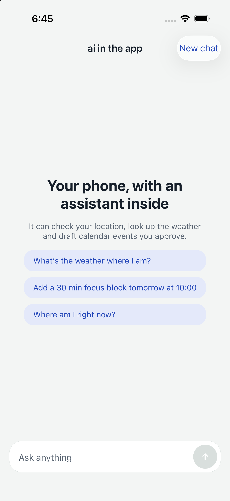
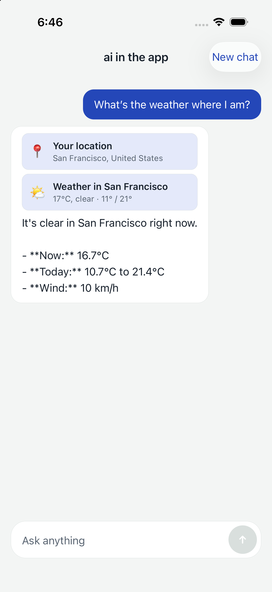
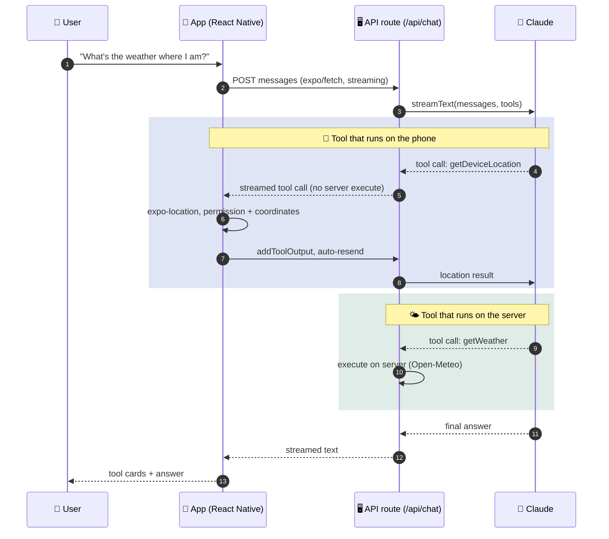

<div align="center">


# 🤖 ai in the app

**An AI assistant that can use the phone it runs on.**

Answers stream in as they're written, the assistant calls native features through tools,
and the chat keeps working when the connection drops.

<br />


[🎬 Demo](#-demo) ·
[✨ Features](#-what-it-does) ·
[🧭 How it works](#-how-it-works) ·
[🗂️ Project map](#️-project-map) ·
[🚀 Run it](#-run-it) ·
[☁️ Deploy](#️-deploy-the-api) ·
[🔭 Next steps](#-ideas-for-next-steps)

</div>

---

## 🎬 Demo

<div align="center">

<a href="docs/demo.mp4">▶️ Watch the demo video</a>


&nbsp;


</div>

---

## ✨ What it does

| | Feature | Details |
| :-: | --- | --- |
| ⚡ | **Streaming chat** | Replies render token by token over `expo/fetch`. |
| 📍 | **Tools that run on the phone** | The model can ask for the device location (`expo-location`) and draft a calendar event (`expo-calendar`). On iOS the event opens in the native sheet, so the user always decides whether to save it. |
| 🌤️ | **A server tool** | `getWeather` runs in the API route and calls [Open-Meteo](https://open-meteo.com) (no key needed). |
| 🧩 | **Visible tool calls** | Every tool call renders as a card with its state: 🟦 running, 🟩 done or 🟥 failed. |
| 📴 | **Offline fallback** | History is saved on the device. Messages written offline are queued, shown as "queued", and sent in order once the connection is back. |
| 🌗 | **Light and dark mode** | Spacing and type scales built on the golden ratio (φ ≈ 1.618). |

## 🧭 How it works



> 🔐 **The API key only lives on the server.** The app never sees it.

## 🗂️ Project map

| | File | Role |
| :-: | --- | --- |
| 🖥️ | [`src/app/api/chat+api.ts`](src/app/api/chat+api.ts) | API route: model, system prompt, `streamText`, streaming response |
| 🧰 | [`src/lib/tools.ts`](src/lib/tools.ts) | Tool schemas shared by server and app; `getWeather` runs on the server |
| 📱 | [`src/lib/native-tools.ts`](src/lib/native-tools.ts) | Phone-side tool implementations (location, calendar) |
| 💬 | [`src/app/index.tsx`](src/app/index.tsx) | Chat screen: `useChat`, `onToolCall`, offline queue, persistence |
| 🧱 | [`src/components/`](src/components) | Message bubble and tool card |
| 🎨 | [`src/theme.ts`](src/theme.ts) | Colors (light/dark) and golden-ratio spacing |

## 🚀 Run it

```bash
npm install
cp .env.example .env        # add your ANTHROPIC_API_KEY
npx expo run:ios            # or: npx expo run:android
```

> [!IMPORTANT]
> Location and calendar are native modules, so use a **development build** (`expo run:*` or
> `eas build --profile development`) rather than Expo Go.

> [!TIP]
> Set `AI_MODEL` in `.env` to use a different Claude model (default `claude-sonnet-5-5`).

### 🔑 Environment variables

| Variable | Required | Purpose |
| --- | :-: | --- |
| `ANTHROPIC_API_KEY` | 🟥 yes | Claude API key, read by the API route only |
| `AI_MODEL` | 🟦 optional | Claude model id (default `claude-sonnet-5-5`) |
| `EXPO_PUBLIC_API_BASE_URL` | 🟧 production | Where the API routes are deployed |

## ☁️ Deploy the API

```bash
npx expo export --platform web
npx eas-cli@latest deploy
```

Then set `EXPO_PUBLIC_API_BASE_URL` to the deployed URL before building the release app,
and add `ANTHROPIC_API_KEY` to the hosting environment.

## ✅ Checks

```bash
npm run typecheck
npm run lint
npx expo-doctor
```

## 🔭 Ideas for next steps

- [ ] 🧠 On-device model fallback for short answers when offline
- [ ] 🎙️ Voice input with the native speech recognizer
- [ ] 🧪 An eval suite that replays saved conversations against new prompts and models

---

<div align="center">

Made with 💙 using Expo and Claude · Released under the [MIT License](LICENSE)

</div>
