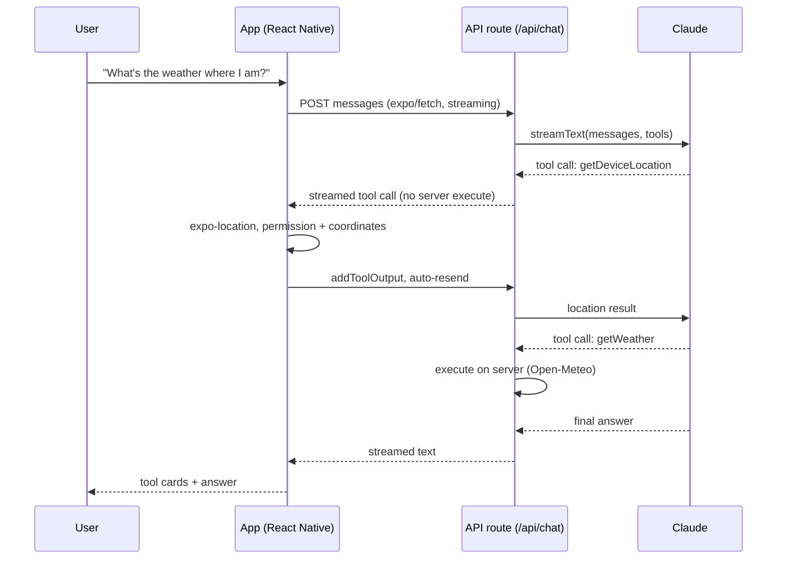

# ai in the app

A React Native app with an AI assistant that can use the phone it runs on.
Answers stream in as they're written, the assistant calls native features through tools,
and the chat keeps working when the connection drops.

Built with Expo SDK 58, Expo Router API routes, the Vercel AI SDK 7 and Claude.

## What it does

- **Streaming chat.** Replies render token by token over `expo/fetch`.
- **Tools that run on the phone.** The model can ask for the device location (`expo-location`) and draft a calendar event (`expo-calendar`). On iOS the event opens in the native sheet, so the user always decides whether to save it.
- **A server tool.** `getWeather` runs in the API route and calls Open-Meteo (no key needed).
- **Visible tool calls.** Every tool call renders as a card with its state: running, done or failed.
- **Offline fallback.** History is saved on the device. Messages written offline are queued, shown as "queued", and sent in order once the connection is back.
- **Light and dark mode**, with spacing and type scales built on the golden ratio.

## How it works



The API key only lives on the server. The app never sees it.

| File | Role |
| --- | --- |
| `src/app/api/chat+api.ts` | API route: model, system prompt, `streamText`, streaming response |
| `src/lib/tools.ts` | Tool schemas shared by server and app; `getWeather` runs on the server |
| `src/lib/native-tools.ts` | Phone-side tool implementations (location, calendar) |
| `src/app/index.tsx` | Chat screen: `useChat`, `onToolCall`, offline queue, persistence |
| `src/components/` | Message bubble and tool card |
| `src/theme.ts` | Colors (light/dark) and golden-ratio spacing |

## Run it

```bash
npm install
cp .env.example .env        # add your ANTHROPIC_API_KEY
npx expo run:ios            # or: npx expo run:android
```

Location and calendar are native modules, so use a development build (`expo run:*` or
`eas build --profile development`) rather than Expo Go.

Optional: set `AI_MODEL` in `.env` to use a different Claude model (default `claude-sonnet-5-5`).

## Deploy the API

```bash
npx expo export --platform web
npx eas-cli@latest deploy
```

Then set `EXPO_PUBLIC_API_BASE_URL` to the deployed URL before building the release app,
and add `ANTHROPIC_API_KEY` to the hosting environment.

## Checks

```bash
npm run typecheck
npm run lint
npx expo-doctor
```

## Ideas for next steps

- On-device model fallback for short answers when offline
- Voice input with the native speech recognizer
- An eval suite that replays saved conversations against new prompts and models
