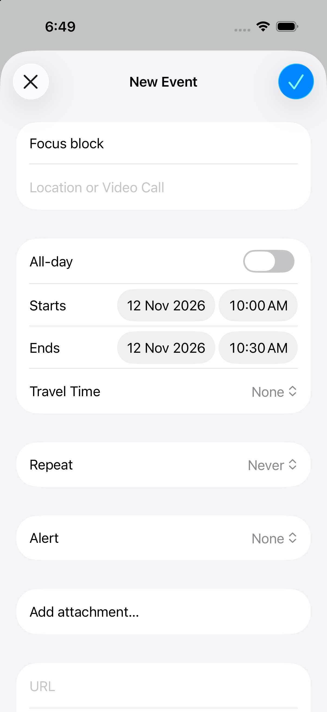
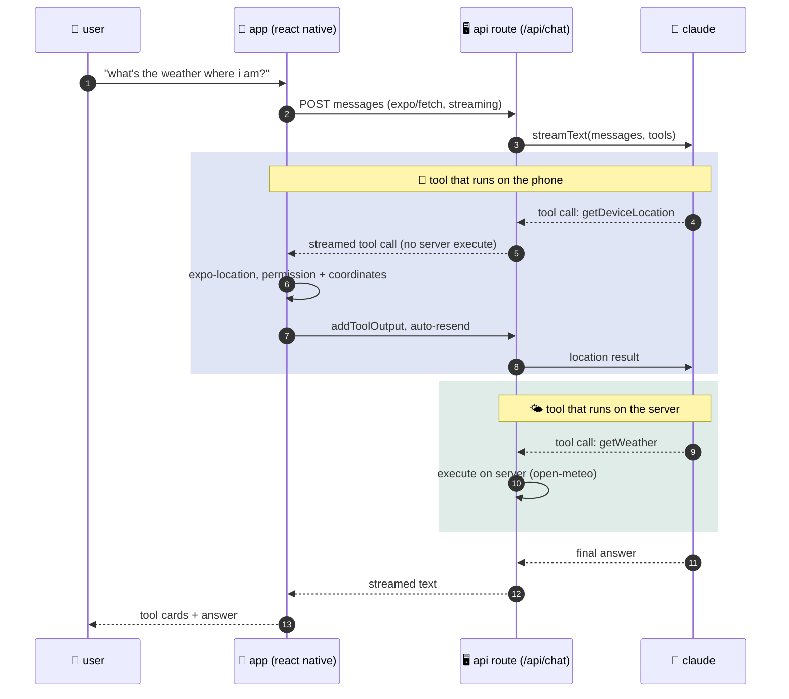

<div align="center">


# 🤖 ai in the app

**an ai assistant that can use the phone it runs on.**

answers stream in as they're written, the assistant calls native features through tools,
and the chat keeps working when the connection drops.

<br />


[🎬 demo](#-demo) ·
[✨ features](#-what-it-does) ·
[🧭 how it works](#-how-it-works) ·
[🗂️ project map](#️-project-map) ·
[🚀 run it](#-run-it) ·
[☁️ deploy](#️-deploy-the-api) ·
[🔭 next steps](#-ideas-for-next-steps)

</div>

---

## 🎬 demo

<div align="center">

<a href="docs/demo.mp4">▶️ watch the demo video</a>


&nbsp;

&nbsp;


</div>

---

## ✨ what it does

| | feature | details |
| :-: | --- | --- |
| ⚡ | **streaming chat** | replies render token by token over `expo/fetch`. |
| 📍 | **tools that run on the phone** | the model can ask for the device location (`expo-location`) and draft a calendar event (`expo-calendar`). on ios the event opens in the native sheet, so the user always decides whether to save it. |
| 🌤️ | **a server tool** | `getWeather` runs in the api route and calls [open-meteo](https://open-meteo.com) (no key needed). |
| 🧩 | **visible tool calls** | every tool call renders as a card with its state: 🟦 running, 🟩 done or 🟥 failed. |
| 📴 | **offline fallback** | history is saved on the device. messages written offline are queued, shown as "queued", and sent in order once the connection is back. |
| 🌗 | **light and dark mode** | spacing and type scales built on the golden ratio (φ ≈ 1.618). |

## 🧭 how it works



> 🔐 **the api key only lives on the server.** the app never sees it.

## 🗂️ project map

| | file | role |
| :-: | --- | --- |
| 🖥️ | [`src/app/api/chat+api.ts`](src/app/api/chat+api.ts) | api route: model, system prompt, `streamText`, streaming response |
| 🧰 | [`src/lib/tools.ts`](src/lib/tools.ts) | tool schemas shared by server and app; `getWeather` runs on the server |
| 📱 | [`src/lib/native-tools.ts`](src/lib/native-tools.ts) | phone-side tool implementations (location, calendar) |
| 💬 | [`src/app/index.tsx`](src/app/index.tsx) | chat screen: `useChat`, `onToolCall`, offline queue, persistence |
| 🧱 | [`src/components/`](src/components) | message bubble and tool card |
| 🎨 | [`src/theme.ts`](src/theme.ts) | colors (light/dark) and golden-ratio spacing |
| 🧪 | [`src/__tests__/`](src/__tests__), [`src/lib/__tests__/`](src/lib/__tests__) | jest tests for the api route, tools, native tools, storage and api url |

## 🚀 run it

```bash
npm install
cp .env.example .env        # add your ANTHROPIC_API_KEY
npx expo run:ios            # or: npx expo run:android
```

> [!IMPORTANT]
> location and calendar are native modules, so use a **development build** (`expo run:*` or
> `eas build --profile development`) rather than expo go.

> [!TIP]
> set `AI_MODEL` in `.env` to use a different claude model (default `claude-sonnet-5-5`).

### 🔑 environment variables

| variable | required | purpose |
| --- | :-: | --- |
| `ANTHROPIC_API_KEY` | 🟥 yes | claude api key, read by the api route only |
| `AI_MODEL` | 🟦 optional | claude model id (default `claude-sonnet-5-5`) |
| `EXPO_PUBLIC_API_BASE_URL` | 🟧 production | where the api routes are deployed |

## ☁️ deploy the api

```bash
npx expo export --platform web
npx eas-cli@latest deploy --prod
```

then set `EXPO_PUBLIC_API_BASE_URL` to the **production url** (for example `https://ai-in-the-app.expo.app`)
before building the release app, and add `ANTHROPIC_API_KEY` to the hosting environment.

> [!WARNING]
> without `--prod`, each deploy gets its own address (`…--<id>.expo.app`) that never changes.
> pointing the app at one of those keeps it on old code after you redeploy.

## ✅ checks

```bash
npm run typecheck
npm run lint
npm test          # Jest + jest-expo; use `npm run test:watch` while developing
npx expo-doctor
```

the tests mock the native modules and the model, so they run without a device, network or api key.

## 🔭 ideas for next steps

- [ ] 🧠 on-device model fallback for short answers when offline
- [ ] 🎙️ voice input with the native speech recognizer
- [ ] 🧪 an eval suite that replays saved conversations against new prompts and models

---

<div align="center">

made with 💙 using expo and claude · released under the [mit license](LICENSE)

</div>
